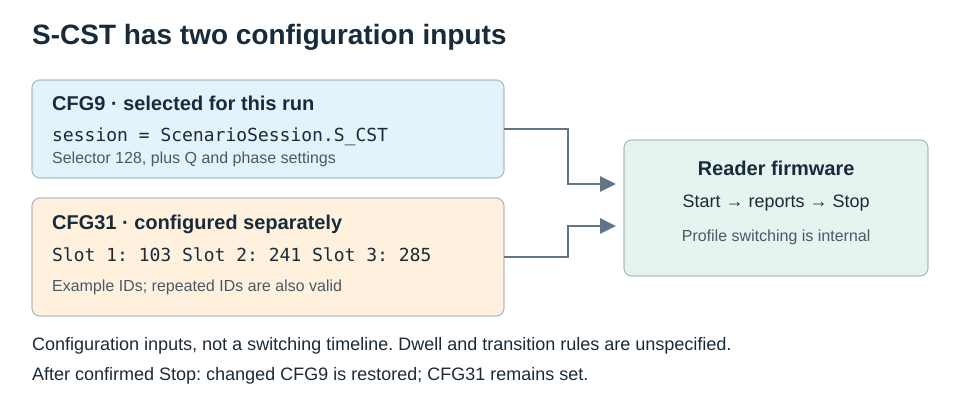

# Inventory

Most applications need only Answer for bounded scans or Scenario for continuous
Ex10 reading. Real-time is optional: use it for reader-controlled startup or a
hardware trigger with the existing reader configuration. It is not required for
continuous reading, S-CST, or higher throughput.

| Mode | Start and stop | Configuration |
|---|---|---|
| Answer round | `inventory_once()`; finishes on the terminal response | `InventoryConfig` for each round |
| Answer session | `start_inventory(InventoryMode.ANSWER)`; host repeats rounds | One antenna per round; optional ordered `antenna_sequence` |
| Scenario | `start_inventory(InventoryMode.SCENARIO)`; `0x50 → 0xEE → 0x51` | Temporary query, TID, mask, and antenna configuration |
| Real-time (optional) | `start_inventory(InventoryMode.REAL_TIME)`; temporary `0x76=0x81`, stop with `0x80` | `RealTimeConfig` set with `set_real_time_config()` |
| Trigger (optional) | Real-time session with `trigger=True`; temporary `0x76=0x82` | Reader input wiring and configuration |
| Buffered | `inventory_to_buffer()`, then `read_buffer()` | Caller specifies the stored data kind |
| Single / EPC match | `inventory_single()` / `inventory_matching_epc()` | Native `0x0F` / `0x1A` |

## Continuous reading

With an open `reader` in Answer working mode, this session reads for five seconds
and then stops. The SDK checks Work Mode before inventory; it does not silently
switch an autonomous reader. To switch explicitly without changing its boot mode:

```python
from zk_rfid import WorkingMode

(await reader.set_working_mode(WorkingMode.ANSWER, persist=False)).require_success()
```

The default is now `persist=False`. Use `persist=True` only when changing the mode
used after a power cycle. `get_working_mode()` returns the current mode, not a
separate saved boot-mode value. Older firmware may reject temporary mode writes;
the SDK reports that rejection without retrying as a persistent write.

The direct Answer setter also waits for old stream bytes to settle, reads `0x77`,
and settles again before releasing the reader. Successful results have
`confirmation="read_back_verified"`. Old reports are excluded from the next
session; the command's diagnostics record their count and `dispatcher.unsolicited`
retains the last 32 raw unsolicited frames. This does not create an inventory
outcome or prove that the boot mode was saved. A save failure remains `partial`
even if the current Answer mode is verified.

```python
import asyncio
from zk_rfid import InventoryConfig, InventoryMode, TagReport

session = await reader.start_inventory(
    InventoryMode.SCENARIO,
    config=InventoryConfig(antenna=1, phase=True),
)
try:
    async with asyncio.timeout(5):
        async for event in session:
            if isinstance(event, TagReport):
                print(event)  # Includes phase and frequency when reported.
except TimeoutError:
    pass
finally:
    outcome = await session.stop()
    for event in session.drain():
        if isinstance(event, TagReport):
            print(event)
    print(outcome.termination_reason, outcome.complete, outcome.diagnostics)
if not outcome.complete:
    raise RuntimeError("Inventory did not complete; inspect stop diagnostics")
```

Scenario snapshots CFG9/10/11 and antenna selection, applies volatile settings,
and reads back CFG9/10/11 and any changed antenna mask before starting. After a stop ACK, it restores and verifies
the snapshot. Automatic antenna restoration is available for 1-, 4-, and 8-port
layouts; the 16-port getter remains unresolved.

`InventoryConfig` supplies the settings for each run. For example, calling
`set_query_parameters()` with S-CST and then `start_inventory()` without a config
runs with the default S0, Q=4 and phase disabled. The earlier CFG9 is restored
after a confirmed stop. Pass the intended selector in `config.session` instead.

| Setting | Managed by a Scenario session |
|---|---|
| Q, session/mode selector, phase (CFG9) | Applied from `InventoryConfig`; changed values restored after stop |
| TID range and selection mask (CFG10/11) | Applied from `InventoryConfig`; changed values restored after stop |
| Antenna selection | `antenna_mask`, or one `config.antenna` when omitted; previous selection restored where supported |
| Custom profiles (CFG31), RF profile, region, power, CFG7 | Existing settings used; not configured or restored by the session |

For a four-port reader, declare `ReaderCapabilities(antenna_ports=4)`. Use
`config=InventoryConfig(antenna=3)` for ANT3, or
`start_inventory(InventoryMode.SCENARIO, antenna_mask=0b1101)` for ANT1/3/4.
The mask overrides `config.antenna`; bit 0 selects ANT1. It must be nonzero and
within the declared port count. Answer remains one antenna per round and rejects
this keyword. Scenario sends one Start; the reader controls antenna switching,
whose order and timing are not yet verified on four-port hardware.

Answer sessions can instead pass `antenna_sequence=(1, 3, 4)`. The host sends a
round for each port in that order and repeats until Stop. This supports FastID
across selected ports without reconfiguring the saved antenna mask. A round can
finish before its `scan_time_100ms` bound; this parameter is not fixed port dwell.
Multiple ports reject an unlimited (`0`) round. Stop interrupts/joins the current
round and prevents the next port from starting.

A terminal device error, such as antenna error `0xF8`, ends the entire Answer
sequence and raises `DeviceError` to the consumer after queued reports. It does
not skip or retry that port. Always call `stop()` in `finally`, then drain and
inspect the outcome: confirmed cleanup returns idle, but the run remains partial
with the device `status`. The browser bridge performs this cleanup and emits an
`error` event with `inventory_outcome`. No-tag (`0xFB`) continues to the next round;
device timeout (`0x02`) and buffer-full (`0x04`) also continue but mark the run partial.

Scenario temporarily applies exactly the requested selection and restores the
previous mask after confirmed Stop. Pass the UI's selected ports at each Start;
a pre-run disabled port can be re-enabled by an explicit run selection.
Configure power before Start; see the
[four-port integration example](../mapping/nation_to_zk/web_integration.md#four-port-readers).

## Session and Target

In Scenario, `config.session` is the CFG9 selector. It accepts `ScenarioSession`
members or their integer values. Values above 3 select ZK firmware modes, not
additional on-air Gen2 sessions.

| Selector | Value | Meaning and support |
|---|---:|---|
| `S0`–`S3` | 0–3 | Gen2 session selection |
| `S_CST` | 128 | Three custom profile slots from CFG31; switching timing is unspecified |
| `S_CTP` | 252 | Exposed by the V6.8 demo; algorithm and firmware requirements unresolved |
| `S_RPT` | 253 | Named in ZK DLL/Linux manuals; firmware algorithm unresolved |
| `S_PRO` | 254 | Named in ZK DLL/Linux manuals; firmware algorithm unresolved |
| `AUTO` | 255 | Auto selector documented in CFG9; kept separate from the named modes |

The SDK encodes these values; it does not implement or emulate their firmware
algorithms. Answer AUTO-2/AUTO-3 logic in the vendor demo does not establish how
Scenario S-PRO/S-RPT behave. Do not infer a use case from the abbreviations.

`config.target` accepts `0` (A) or `1` (B). The demo also exposes A|B, but its
firmware contract is unresolved and the SDK rejects that value. A Start target
does not establish the target used in every later firmware inventory round.

The SDK does not issue the demo's preparatory Select commands before Start.
The C# demo prepares S2/S3 for S-PRO and S-CST; this is an initialization step,
not evidence of the Session used by every Query. See [errata](protocol/errata.md).

## S-CST

Configure the profile slots separately, then select S-CST in the run configuration:

```python
import asyncio
from zk_rfid import InventoryConfig, InventoryMode, ScenarioSession, WorkingMode

mode = (await reader.get_working_mode()).require_success().mode
if mode is not WorkingMode.ANSWER:
    raise RuntimeError("Switch explicitly to Answer working mode before configuring S-CST")

profiles = (103, 241, 285)
(await reader.set_custom_profiles(profiles, persist=False)).require_success()
actual = (await reader.get_custom_profiles()).require_success()
if actual != profiles:
    raise RuntimeError("Custom profile read-back mismatch")

session = await reader.start_inventory(
    InventoryMode.SCENARIO,
    config=InventoryConfig(session=ScenarioSession.S_CST, q=6, target=0),
)
try:
    async with asyncio.timeout(5):
        async for event in session:
            print(event)
except TimeoutError:
    pass
finally:
    outcome = await session.stop()
    for event in session.drain():
        print(event)
    print(outcome.termination_reason, outcome.complete, outcome.diagnostics)
if not outcome.complete:
    raise RuntimeError("Inventory did not complete; inspect stop diagnostics")
```



CFG31 holds exactly three ordered 16-bit profile IDs. Repeated IDs are valid;
the vendor Android demo includes presets with three identical IDs. Slot order
does not specify dwell time, switching conditions, or a repeating schedule.

**CFG31 remains set after Stop.** `persist=False` avoids saving it to nonvolatile
storage; it does not request restoration at session end. Applications that need
the previous slots must save them and restore them explicitly after a confirmed
stop on a healthy connection. This is separate from the managed CFG9/10/11 cleanup.

For a complete connection and CLI example, use
[`inventory_scenario.py`](../examples/inventory_scenario.py). It uses existing
slots unless `--profiles` is supplied and reports that change explicitly.
It prints phase/frequency fields when present and exits with a nonzero status
if the session is incomplete. A Stop ACK alone does not confirm restoration;
check `outcome.complete` and `outcome.diagnostics` before reusing the reader.

## Tag data

| Data | Behavior |
|---|---|
| EPC | Returns the reported EPC; does not fabricate PC or TID |
| TID | Answer uses the requested TID word range; Scenario uses CFG10, 1–15 words |
| FastID | Answer `0x01`; compatible tags append a 96-bit TID; other tags may return EPC only |
| Mix | `0x19`; pairs EPC and memory records using sequence and antenna; up to 31 memory words |
| Phase | Supported report layouts retain begin/end values and frequency; see [measurements](phase_and_live_view.md) |

Scenario supports EPC or TID-only data. FastID and Mix are not defined for its
managed session contract. Mix records without their matching memory data remain
visible and make the outcome partial.

`get_inventory_mask()` returns a `TagMask`, or `None` when CFG11's bit length is
zero (masking disabled). Use `set_inventory_mask(None)` to clear it. `raw_data`
and `get_config(11, decoded=False)` retain the original bytes, including inactive
bank/address fields; Scenario cleanup restores its exact snapshot.

Real-time uses the reader's current `0x75` configuration. The SDK reads `0x77`
to interpret EPC/TID reports and rejects unsupported phase/statistics requests.
Other Answer fields in `InventoryConfig` do not reconfigure Real-time mode.
`set_real_time_config()` persists its settings. Working-mode changes default to
temporary; managed Real-time Start/Stop never requests a boot-mode change.

## Optional Real-time mode

Use Scenario for a host-controlled stream with per-run configuration and phase
reports. Real-time is useful when the module should read automatically after
startup, or when a wired GPI trigger should control inventory. Trigger mode uses
GPI1 low to read and high to wait; confirm the module's exposed pins and wiring.
Neither mode buffers data on behalf of a disconnected host.

For autonomous startup, configure the reader and explicitly call
`set_working_mode(WorkingMode.REAL_TIME, persist=True)`. The reader starts sending
`0xEE` reports immediately and resumes that mode after restart. A direct mode
setter does not create a Python iterator, and closing its port does not stop RF.

For a managed consumer, see [inventory_realtime.py](../examples/inventory_realtime.py).
It uses the existing EPC/TID settings, stops into temporary Answer mode, and
drains queued events. It does not restore a previously active autonomous mode,
which would immediately restart RF, or change the saved boot mode. Most users
can skip this example and stay with Answer/Scenario.

## Completion and stopping

Answer status `0x03` means more frames, `0x01` means completion, `0x02` means
device timeout, and `0x04` means buffer full. Statistics requests also wait for
`0x26`. Status `0xFB` means no tag. Completion confirms the protocol exchange;
it does not establish that all physical tags were found.

- Answer `0x01` stops with `0x93`, which has no independent ACK.
- Mix `0x19` has no asynchronous stop command; it finishes the current round.
- Scenario stops with `0x51`, settles the stream, then restores configuration.
- Real-time stops with temporary Answer mode (`0x76=0x80`) and verifies `0x77`.

Cancelling a consumer is not a device stop. Call `stop()` in `finally`, then
`drain()` to take already decoded events still in the queue. Use one consumer;
do not drain concurrently with it. Stream outcomes contain counters rather than
a second copy of all reports. Cancelling `stop()` waits for cleanup before
propagating cancellation.

`reader.stop_inventory()` also waits for an in-progress Start, including its
Work Mode check, then stops the resulting session. A second Start is rejected
while Start, Stop or close is pending. Keep the UI in Starting/Stopping until
the corresponding operation resolves.

If transmitting Answer's interrupt fails, Stop still joins the round and closes
the host session. Its outcome is `unknown`, the reader requires recovery, and
`drain()` remains available for reports already received. Repeated Stop calls
on that session return the same outcome without retransmitting.

After a lost Start ACK, there may be no session to stop even though RF could be
active. `reader.stop_inventory()` then returns `unknown`, `complete=False`, and
`stop_unconfirmed`, without transmitting a guessed opcode. It also preserves
uncertainty when called again after a failed Stop. A false `is_inventory_running`
value is not proof of idle hardware; recover the connection before reuse.

After a Stop ACK, the SDK observes 50 ms without received bytes, with a 500 ms
limit per settling check. Real-time also settles after its mode read-back.
Streaming Stop reserves up to one additional second for these checks beyond
the normal command-operation timeout.
During managed Stop, post-ACK `0xEE` frames are quarantined, never delivered as tags
or assigned to the next session. They make the outcome `partial`; `quarantined_count` records the
total and `quarantined_frames` retains the last 32 raw frames. This includes
malformed post-ACK reports; validation of active reports remains strict.

A rejected Stop, failed mode read-back, incomplete frame, or stream that does
not become quiet leaves the reader `unknown`. A report arriving after cleanup
also faults the connection. The settling interval is a host observation, not a
firmware guarantee. Inspect `complete`, `diagnostics`, and the current reader
state before reuse. See [recovery](api.md#recovery).

## Timing and throughput

For Answer rounds, `scan_time_100ms` is in 100 ms units; zero requests an unlimited
scan. The default round deadline includes a 250 ms margin. A repeating Answer
session starts further rounds until stopped.

Scenario runs until explicitly stopped. `scan_time_100ms` does not limit it;
use an application timer, as above. CFG7 interval/dwell/count are separate reader
settings and do not define the duration of the Python session or a verified
S-CST profile schedule. An explicit command timeout covers the operation,
including waiting for the lock; it is not a Scenario run timer.

The dispatcher has one RX consumer and each session has a bounded event queue.
Overflow raises `QueueOverflow` and increments `dropped_count`. Heartbeats are
separate events and do not count as tags. Keep processing lightweight or hand
reports to an application queue.

For RF performance comparisons, use the [benchmark procedure](inventory_benchmark.md).
Report rate alone is not a measure of tag completeness.
