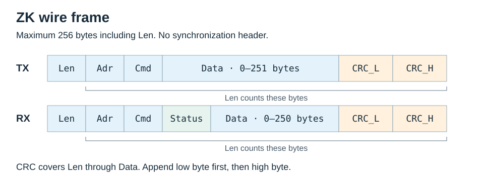

# Wire format

The SDK implements the Gen2/6C reader protocol described in the UHF RFID Reader
Series User Manual V2.25.



`Len` counts all bytes after itself. It is an unsigned byte, so the complete
frame is at most 256 bytes: command data at most 251 bytes, response data at most
250 bytes. There is no `0x5A` synchronization header.

Address `0xFF` broadcasts to a single connected reader; the response contains
the reader's own address. Concurrent responses from several readers on one bus
are not supported.

## CRC

| Parameter | Value |
|---|---|
| Reflected polynomial | `0x8408` |
| Initial value | `0xFFFF` |
| Final XOR | `0x0000` |
| Coverage | `Len` through the final payload byte |
| Wire order | Low byte, then high byte |
| Check input `123456789` | `0x6F91` |
| Valid complete-frame residue | `0x0000` |

Reader-info broadcast example:

```text
04 FF 21 19 95
│  │  │  └──── CRC, low byte first
│  │  └─────── Command: reader information
│  └────────── Broadcast address
└───────────── Four bytes follow Len
```

The [eight documented TX vectors](../../fixtures/zk/documented/frames.json) come
from historical vendor-DLL loopback results. They are independent byte references,
not new RF captures.

## Parsing and dispatch

`FrameParser` accepts arbitrary byte chunks, handles multiple frames per chunk,
checks CRC, and resynchronizes after invalid data. Diagnostics count discarded
bytes, CRC failures, and buffer overflow. Parser recovery can preserve useful
reports while still making an inventory outcome partial.

The dispatcher registers a pending request before TX and matches responses by
command and address. `0xEE` is a notification; `0x93` has no independent ACK.
The special `0x00/0xFE` error context is handled separately. Late or unexpected
responses fault the connection to prevent assignment to a subsequent request.

Deadlines cover the operation lock and complete multi-step exchange. Short writes
continue the unaccepted bytes only. A transport read of `b""` means EOF, not an
ordinary serial polling timeout. OS chunk timestamps do not establish wire-byte
timing. See [recovery](../api.md#recovery) after an uncertain exchange.
