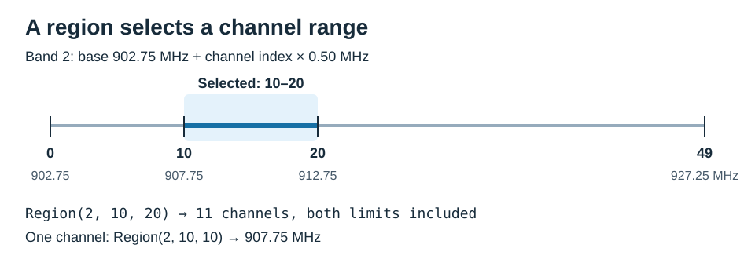

# RF settings

Region selects the frequency channels. An RF profile selects the modulation and
timing used to communicate with tags. A Scenario selector controls the reader's
inventory mode; see [Inventory](inventory_modes.md#session-and-target).

## Region

`Region(band, min_channel, max_channel)` uses native ZK band IDs and **zero-based,
inclusive channel indices**. For a linear band:

```text
frequency_khz = base_khz + channel * spacing_khz
```



With an open `reader`, read the configured range and convert it to MHz:

```python
from zk_rfid import CustomRegion, channel_frequency_khz

region = (await reader.get_region()).require_success()
if isinstance(region, CustomRegion):
    print(region.start_frequency_khz / 1000, region.last_frequency_khz / 1000, "MHz")
else:
    for channel in (region.min_channel, region.max_channel):
        print(channel, channel_frequency_khz(region.band, channel) / 1000, "MHz")
```

For example, `Region(2, 0, 49)` describes 902.75–927.25 MHz. To select one channel,
use equal limits: `Region(2, 10, 10)` describes 907.75 MHz. Apply a range chosen for
your deployment with `await reader.set_region(region)` and check the result with
`require_success()`. Changes are volatile unless `persist=True`.

These names match the Ex10 V6.8 demo, not current regional operating permissions:

| Demo option | Band ID | Channels | Frequency range (MHz) | Spacing (kHz) |
|---|---:|---|---|---:|
| Chinese band1 | 8 | 0–19 | 840.125–844.875 | 250 |
| Chinese band2 | 1 | 0–19 | 920.125–924.875 | 250 |
| US band | 2 | 0–49 | 902.750–927.250 | 500 |
| EU3 band | 9 | 0–3 | 865.700–867.500 | 600 |
| Korean band | 3 | 0–31 | 917.100–923.300 | 200 |
| EU band | 4 | 0–14 | 865.100–867.900 | 200 |
| US band3 | 12 | 0–52 | 902.000–928.000 | 500 |
| ALL band | 0 | 0–60 | 840.000–960.000 | 2000 |
| Japan band | 31 | 0–3 | 916.800–920.400 | 1200 |

The demo's Minfre/Maxfre controls display frequencies for these indices; **Single**
selects equal limits. The SDK exposes additional native bands in `REGIONS`.
Bands 21 and 29 support native set/get, but `channel_frequency_khz()` raises
`UnverifiedFeature` because their discontinuous formulas are ambiguous.

Legacy `set_region(..., legacy=True)` is only for band IDs up to 15 and requires
`persist=True`. Changing the local `REGIONS` table does not program reader channels.

### Custom Region

Use `set_custom_region(start_frequency_khz, channel_count, spacing_khz)` for a
channel plan supplied by your application. It replaces the active native region.
The SDK sends the plan; it does not choose a country's operating configuration.

```python
from zk_rfid import CustomRegion

async def apply_custom_channels(reader, start_khz, count, spacing_khz):
    desired = CustomRegion(start_khz, count, spacing_khz)
    (await reader.set_custom_region(start_khz, count, spacing_khz)).require_success()
    actual = (await reader.get_custom_region()).require_success()
    if actual != desired:
        raise RuntimeError("Custom Region read-back mismatch")
    return actual
```

Start is the first **channel center**, not the lower occupied-band edge. The last
center is `start_frequency_khz + (channel_count - 1) * spacing_khz`.
The demo's **Space** is a multiplier: Space `4` means `spacing_khz=500` in the
SDK. Start `918000`, Count `8`, Space `4` selects channel centers 918.0–921.5 MHz.
With Save checked, the matching call is
`await reader.set_custom_region(918000, 8, 500, persist=True)`.

Count is 1–61. Spacing must be a multiple of 125 kHz, up to 31875 kHz; zero is
accepted only for one channel. Start and last center must fit unsigned 24-bit kHz.
These are API/encoding limits, not the module's RF tuning range or operating
permissions. Reader firmware can reject a plan that passes local validation.

Writes are volatile unless `persist=True`. `get_region()` returns `Region` or
`CustomRegion` according to the active plan; `get_custom_region()` returns `None`
when a native region is active. Neither getter exposes a separate saved plan.
Immediate read-back confirms the current plan; retention needs a power-cycle check.
Sessions do not change or restore frequency settings. To restore a snapshot, use
`set_region()` for `Region`, or `set_custom_region()` for `CustomRegion`.

Web Serial exposes `reader.setCustomRegion(plan, persist)` and
`reader.getCustomRegion()`, using the same three snake_case fields. See the
[web example](../web/README.md#custom-region).

## RF profiles

Use the [profile table](rf_profiles.md) to inspect known IDs. It is generated from
the SDK's `PROFILES` metadata, which describes parameters rather than detected
reader capabilities.

```python
from zk_rfid import PROFILES

profile_id = (await reader.get_profile()).require_success()
definition = PROFILES.get(profile_id)
print(profile_id, definition)  # None means the ID is absent from the local table.

# Example selection: confirm this ID is supported by your firmware.
(await reader.set_profile(241, persist=False)).require_success()
```

Tari, PIE and modulation describe the reader-to-tag link. BLF and encoding
describe the tag reply. BLF is not the RF carrier frequency or the report rate.
Different settings trade airtime against RF performance; measure the result with
your tags, antenna layout and reader firmware.

`set_profile()` selects one native profile through command `0x7F`. The default
extended format accepts 16-bit IDs; `extended_format=False` selects the legacy
6-bit ID format. Similar displayed parameters do not establish equivalent
behavior between different profile IDs or reader families.

For **S-CST**, use three ordered slots through `set_custom_profiles()` instead.
Setting those slots does not activate S-CST, and setting a single profile does
not replace them. Follow the [S-CST example](inventory_modes.md#s-cst).

S-CST can use ordinary Gen2 profiles, including 103, 241 and 285. The table also
contains PSK/BPSK and M+B entries associated with the vendor's Gen2X extensions;
their presence does not establish support on the attached reader or tags.
S-CST itself does not require Gen2X.

## Range Control

`get_range_control()` reads CFG16 as an integer from 0 to 100.
`set_range_control(value, persist=False)` writes the same native scale. No
conversion to distance, dB or percentage is established.
Support follows the Ex10 V6.8 demo and reader traces, not the V2.25 CFG table.

With an open, idle reader in Answer working mode:

```python
print("Range Control:", (await reader.get_range_control()).require_success())
(await reader.set_range_control(90)).require_success()  # Volatile.
actual = (await reader.get_range_control()).require_success()
if actual != 90:
    raise RuntimeError("Range Control read-back mismatch")
```

The payload is `00 00 00 value`; decoded reads require exactly four bytes and
a value in 0-100. `get_config(16, decoded=False)` and `raw_data` preserve the bytes.
Use `persist=True` only to save the value; immediate read-back does not verify
retention after power loss. Inventory sessions do not change or restore CFG16;
temporary experiments must save and restore the original value explicitly.

## Impinj settings

These settings are separate from the S-CST profile slots. Configuring them does
not itself start inventory or prove that a Gen2X round is running.

| Demo control | SDK support | Purpose |
|---|---|---|
| TagFocus | `get_tag_focus()` / `set_tag_focus()`; CFG8 | Suppress repeated reads of compatible tags to focus on unread tags |
| Impinj Scan | `get_config(25)` / `set_config(25, ...)` | Configure Scan reply coding, protection and identifier format |
| Impinj ScanID | `get_config(29)` / `set_config(29, ...)` | Configure ScanID enable, mask size and mask value |

TagFocus is available with compatible tags in ordinary Gen2 operation. Impinj
describes suppression by refreshing the tag's S1 B state; this favors unique-tag
inventory over repeated observations. For phase/RSSI tracking, measure the impact
on sample rate. ZK documents a fixed CFG7 dwell of 200 ms when TagFocus is enabled.
The SDK does not select S1 automatically, and S-CST's internal session schedule
remains unresolved.

CFG25 has six bytes, in this order:

| Field | Native values | Meaning |
|---|---|---|
| N | `15` | Value used by the manual and demo |
| Code | `1` Antipodal, `2` CCOneHalf, `3` CCThreeQuarters | Tag reply coding selection |
| CR | `0` ID32, `1` ID16, `2` StoredCRC, `3` RN16 | Short reply format used during inventory |
| Protection | `0` None, `1` Parity, `2` CRC5, `3` CRC5Plus | Communication error protection, not encryption or tag locking |
| ID | `0` NoAckResponse, `1` TMNPlusTSN, `2` Part EPC, `3` Full EPC | Identifier response selection |
| Copyto | `0` All tags, `1` S=1 tags only | Scope as named by ZK; the manual does not define `S` sufficiently to equate it with Session S1 |

CFG29 has five bytes: enable (`0`/`1`), Appsize (`0` RFU, `1` 24 bits, `2` 16 bits,
`3` 8 bits), then a three-byte AppID in big-endian order. ZK calls AppID a mask
value but does not specify its full matching semantics. It is not a substitute
for the bank/address/length contract of CFG11. RFU is reserved, not automatic;
the SDK rejects enabled ScanID with Appsize 0.

Both getters return raw bytes. Setters require explicit
`ReaderCapabilities(cfg25_length=6, cfg29_length=5)` because the manual's summary
and detailed lengths disagree. Declare only the layouts confirmed for the reader.
For example, after confirming CFG25's six-byte layout:

```python
# Construct the reader with ReaderCapabilities(cfg25_length=6).
scan = bytes.fromhex("0F 01 03 02 03 00")
(await reader.set_config(25, scan, persist=False)).require_success()
if (await reader.get_config(25)).require_success() != scan:
    raise RuntimeError("Impinj Scan read-back mismatch")
```

This matches Antipodal / RN16 / CRC5 / Full EPC / All tags. The demo's Set button
writes CFG25 and CFG29 separately with saving enabled; the SDK defaults to volatile
writes. An ACK for CFG25 confirms neither CFG29 nor the selected RF behavior.
These settings remain caller-managed and are not restored by Scenario cleanup.

Impinj's Gen2X Scan and reply-coding enhancements require compatible reader
firmware and tags. Ordinary Gen2 inventory and S-CST with Gen2 profiles do not
require configuring them. Raw CFG access does not establish SDK report support
for every alternate ID format, such as partial EPC or TMNPlusTSN. Keep the known
Full EPC format until the complete report path has been verified.

Sources: ZK V2.25 sections 8.5.2.2, 8.5.2.6 and 8.5.2.7; V6.8 `Form1.cs`;
[Impinj M700 datasheet, section 3.5](https://support.impinj.com/hc/article_attachments/30596888296595);
[Impinj Gen2X](https://www.impinj.com/products/technology/gen2x).

For measurements, use [RF benchmarking](inventory_benchmark.md). Protocol sources
and unresolved behavior are listed in [errata](protocol/errata.md).
