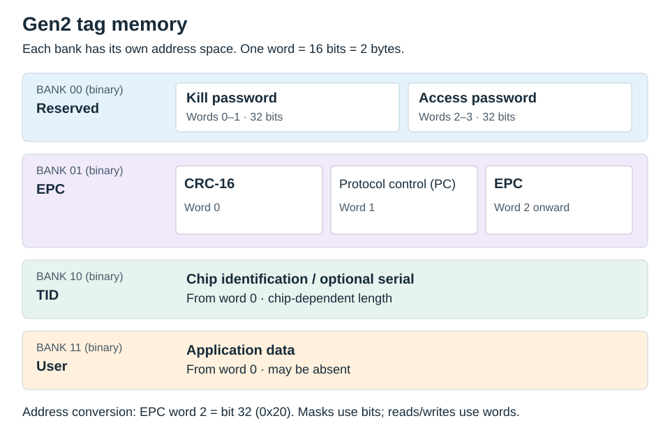
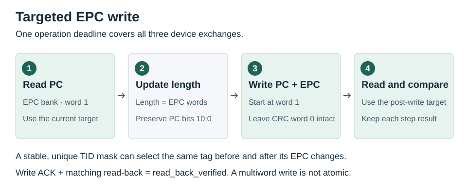

# Tag memory

Gen2 tags expose four memory banks. Memory commands address **16-bit words**;
selection masks address **bits**. One word is two bytes, so EPC word 2 starts at
bit 32 (`0x20`).



This is the layout used by the SDK's basic memory operations. Tag capacity,
optional XPC fields, and protection rules depend on the chip; check its datasheet.
The bank organization follows [GS1 Gen2](https://ref.gs1.org/standards/gen2/).

## Select a tag

Use a full EPC for a tag whose EPC will not change:

```python
from zk_rfid import MemoryBank, TagMask, TagTarget

target = TagTarget(epc=bytes.fromhex("E20034120123456789000001"))
```

For an EPC write, prefer a TID mask that uniquely identifies the intended tag and
remains unchanged. Replace this example TID with one read from your test tag:

```python
tid = bytes.fromhex("E280116060000205DEADBEEF")
target = TagTarget(mask=TagMask(MemoryBank.TID, 0, len(tid) * 8, tid))
```

A chip-family TID prefix may match several tags. Use enough identifying bits and
verify uniqueness in your RF field. A missing target is unfiltered access, not
automatic selection of a single tag.

Full-EPC targets accept 1–15 words. Masks accept banks 1–3, bit addresses 0–16383,
and 1–255 significant bits for tag targeting. Unused low bits in the last mask
byte must be zero, and the mask must fit within the address range.

## Read and write

With an open `reader` and the target above:

```python
data = (await reader.read_memory(
    MemoryBank.USER, word_address=0, word_count=2, target=target,
)).require_success()
print(data.hex().upper())

result = await reader.write_memory(
    MemoryBank.USER, word_address=0, data=bytes.fromhex("1234ABCD"),
    target=target, verify=True,
)
result.require_success()
print(result.confirmation)
```

Use a writable test tag with sufficient User memory for this example. Reads accept
1–120 words; ordinary writes accept 1–32 words with an even byte count. The SDK
selects extended opcodes `0x15`/`0x16` when the starting word address exceeds 255.
`extended_format` can select the format explicitly. Frame size and address bounds
are checked before transmission; the SDK does not split or retry writes.

## Write an EPC

```python
result = await reader.write_epc(
    bytes.fromhex("E20034120123456789000002"), target=target,
)
result.require_success()
```



`write_epc()` updates the PC length field while preserving its lower 11 bits, then
writes PC and EPC together starting at EPC word 1. It does not write CRC word 0.
Verification is enabled by default and shares the operation deadline. A multiword
write is not guaranteed atomic by the SDK or tag.

When selecting by the old EPC, provide a target for the new EPC explicitly:

```python
new_epc = bytes.fromhex("E20034120123456789000002")
result = await reader.write_epc(
    new_epc,
    target=TagTarget(epc=bytes.fromhex("E20034120123456789000001")),
    verification_target=TagTarget(epc=new_epc),
)
result.require_success()
```

The helper accepts up to 31 EPC words, subject to tag capacity and frame size.
For EPCs longer than 15 words, use a stable mask because full-EPC targeting has a
smaller limit. Native `write_epc_single()` uses opcode `0x04`, requires exactly one
physical tag in the field, and is limited to 1–14 words; see [errata](protocol/errata.md).

## Verification

| Result | Interpretation |
|---|---|
| `read_back_verified` | Write acknowledged and selected read-back matches |
| `partial` after ACK | Write acknowledged, but verification failed or mismatched |
| `unknown` after TX | The write may have occurred; recover and inspect before deciding what to do next |

The result retains individual `steps` and native errors. If a write changes the
mask's selected memory, supply a new `verification_target`. Cancellation during
verification preserves acknowledged steps in `reader.last_result`.

## Passwords and protection

Kill and Access passwords are each four bytes. `set_access_password()` writes
Reserved words 2–3 and uses the new password for verification.
`set_kill_password()` writes words 0–1 while authenticating with the Access password.
Writing a password does not lock memory or execute Kill.

Direct `write_memory()` calls overlapping the Access password require
`verification_password` when verification is enabled. `lock_tag()` uses
`LockTarget` and `LockProtection`; permanent protection can be irreversible.
`kill_tag()` requires an explicit target and a nonzero Kill password and permanently
disables a compliant tag.

`block_write()` has a frame budget determined by the target length.
`block_erase()` accepts 1–120 words and starts at word 1 or later for the EPC bank.
Both depend on chip support. Native `0xFC` and its nested `tag_error` distinguish
locked memory, address overrun, and other tag errors.
